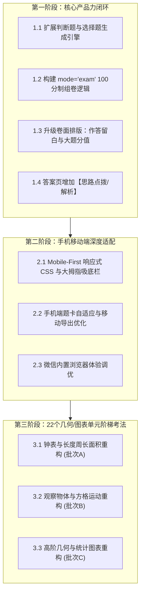

# 小学数学出题小程序 · 六大核心升级工程技术规范 (SIX_CORE_UPGRADES_SPEC)

> **创建日期**：2026-11-12  
> **文档定位**：本项目系统性演进的总体工程蓝图。针对产品结构、题型丰富度、考法深度、答案解析、卷面排版及手机端适配六大维度，制定统一的技术架构规范与落地施工图纸。  
> **执行铁律**：后续所有代码改动必须严格对照本文档施工，保持纯算法实时生成、零题库存储红线，并保证全部自动化测试套件持续通过。

---

## 目录
1. [六大升级核心目标](#1-六大升级核心目标)
2. [模块一：题型结构升级（判断题与选择题算法引擎）](#2-模块一题型结构升级判断题与选择题算法引擎)
3. [模块二：产品模式升级（“💯 单元测验卷”100分制模拟考）](#3-模块二产品模式升级单元测验卷100分制模拟考)
4. [模块三：卷面排版升级（作答规范留白与分值体系）](#4-模块三卷面排版升级作答规范留白与分值体系)
5. [模块四：参考答案升级（全自动【思路点拨 / 解析】）](#5-模块四参考答案升级全自动思路点拨--解析)
6. [模块五：终端体验升级（手机移动端 Native 体验适配）](#6-模块五终端体验升级手机移动端-native-体验适配)
7. [模块六：题库弹药升级（22 个几何/图表单元阶梯考法）](#7-模块六题库弹药升级22-个几何图表单元阶梯考法)
8. [分阶段施工实施路线图](#8-分阶段施工实施路线图)

---

## 1. 六大升级核心目标

当前项目已经打通了 93 个单元的生成入口、24 个口算/竖式每日一练专项以及高熵去重算法。为了将工具从“基础出题器”跃升为“正规化、全场景、多终端的教育生产力工具”，启动六大核心升级：

| 序号 | 升级维度 | 当前现状 | 目标形态 |
|:---:|:---|:---|:---|
| **1** | **题型结构** | 主要是填空、计算、作图与应用题，缺乏客观辨析题 | 建立**判断题（√/×）**与**单项选择题（A/B/C/D）**独立算法生成引擎 |
| **2** | **产品模式** | 仅有“单元同步练”、“口算练”、“竖式练”三种刷题模式 | 新增**“💯 单元测验卷”**模式，严格按照小学期中期末 100 分制大题排版 |
| **3** | **卷面排版** | 应用题作答行距固定，缺少规范留白与分值 | 统一题型大题分值标注，应用题生成自适应解题虚线框（含“解/答”区域） |
| **4** | **答案体验** | 仅输出最终数字答案，缺乏解题过程 | 增加**【思路点拨 / 避坑要点】**，针对判断、选择与复杂应用题自动出解析 |
| **5** | **终端适配** | 偏 PC 宽屏排版，手机端缺少大拇指操作流与题卡自适应 | **Mobile-First 深度适配**：底部吸底操作栏、胶囊滑动选级、题卡手机自适应 |
| **6** | **题库弹药** | 22 个几何与图表单元以数值递增为主，考法较单一 | 落地 `WEAK_UNITS_REDESIGN_SPEC.md`，实现逆求、极值、陷阱等高阶阶梯考法 |

---

## 2. 模块一：题型结构升级（判断题与选择题算法引擎）

### 2.1 题型数据契约 (Data Contract)
在生成的题目对象中，统一扩展 `judge` 与 `choice` 题型格式：

```javascript
// 判断题标准格式
{
  type: 'judge',
  subtemplateId: 'judge-concept',
  question: '两个质数相乘的积一定是合数。',
  answer: '√', // 仅限 '√' 或 '×'
  explanation: '两个质数的积除了1和它本身外，至少还有这两个质数作为因数，所以一定是合数。'
}

// 选择题标准格式
{
  type: 'choice',
  subtemplateId: 'choice-trap',
  question: '把一个平行四边形框架拉成一个长方形，它的周长（    ）。',
  options: ['A. 变大', 'B. 变小', 'C. 不变', 'D. 无法确定'],
  answer: 'C', // 选项字母 'A' | 'B' | 'C' | 'D'
  explanation: '四条边的长度没有改变，因此周长不变；但高变大了，面积会变大。'
}
```

### 2.2 判断题（True/False）核心考点库
覆盖小学 1~6 年级高频概念混淆点与易错陷阱，由算法动态轮换真假命题（保证每卷真假比例约 1:1，杜绝全对或全错）：
1. **数与运算**：
   - 0 的除法：`0除以任何非0的数都得0` (√) vs `0除以任何数都得0` (×)
   - 因数与倍数：`一个数的倍数一定比它的因数大` (×，如 6 的最大因数和最小倍数都是 6)
   - 小数性质：`小数末尾添上0或去掉0，小数的大小不变` (√) vs `小数点的后面添上0或去掉0，小数大小不变` (×)
   - 质数合数：`所有的偶数都是合数` (×，2 是质数) vs `最小的质数是2` (√)
2. **几何与测量**：
   - 周长面积：`周长相等的长方形，面积也一定相等` (×)
   - 平行四边形特性：`平行四边形具有稳定性` (×，易变形)
   - 三角形内角和：`把一个大三角形剪成两个小三角形，每个小三角形的内角和是90°` (×，仍是 180°)
   - 圆与周长：`大圆的圆周率比小圆的圆周率大` (×，圆周率是固定常数)
3. **统计与比率**：
   - 百分数意义：`一根绳子长 75% 米` (×，百分数不能带计量单位)
   - 折扣概念：`打八折出售就是比原价便宜了 20%` (√)

### 2.3 选择题（Multiple Choice）干扰项生成算法
杜绝无意义的随机数字选项，必须根据典型学生常见算理错误构造干扰项（Distractors）：
- **误加误减型**：如求相差数时把两数相加；
- **漏除以2型**：如三角形/梯形面积公式忘记除以 2；
- **植树两端未加1/减1型**：求间隔数与棵数混淆；
- **单位换算进率错位型**：如面积单位混淆为长度进率（把 100 误当成 10）。

---

## 3. 模块二：产品模式升级（“💯 单元测验卷”100分制模拟考）

### 3.1 模式定位
在原有的三种练习模式基础上，增加第四种旗舰模式：
- `unit`: 📘 单元同步练（平时专项巩固，题量自选 20/30/40）
- `exam`: 💯 **单元测验卷（全真模拟考，标准100分制，大题科学配比）**
- `oral`: ⚡ 口算每日一练（24大范围速算）
- `vertical`: 📝 竖式每日一练（笔算与规范框）

### 3.2 100分制大题结构与分值规范
测验卷默认时长 60 分钟，满分 100 分。根据小学教学常规，卷面大题结构固定如下：

```
┌──────────────────────────────────────────────────────────────────┐
│                   人教版小学数学X年级X册 单元测验卷              │
│       时间：60分钟     满分：100分     班级：_____  姓名：_____  │
├──────────────────────────────────────────────────────────────────┤
│ 一、用心思考，正确填空。（共10小题，每空1分，共20分）           │
│ 二、火眼金睛，明辨是非。（对的画“√”，错的画“×”，共5小题，共10分） │
│ 三、仔细推敲，精挑细选。（将正确答案序号填在括号里，共5小题，共10分）│
│ 四、神机妙算，细心计算。（共30分）                              │
│     1. 直接写得数（8分，8小题）                                  │
│     2. 列竖式计算（带★的要验算）（12分，4小题）                  │
│     3. 脱式计算 / 简便运算 / 解方程（10分，3~4小题）              │
│ 五、动手动脑，实践操作。（共10分，作图/观察/测量）              │
│ 六、走进生活，解决问题。（共4小题，每题5分，共20分）            │
└──────────────────────────────────────────────────────────────────┘
```

> **低年级（1~2年级）微调适配**：1~2年级无脱式计算与复杂方程，四、计算题调整为口算（16分）+ 竖式（14分）；低年级适当精简判断题文字量，强化识图连线与动手圈画。

---

## 4. 模块三：卷面排版升级（作答规范留白与分值体系）

### 4.1 大题与小题分值体系
在卷面渲染时，每道大题必须输出标准分值提示：
- 填空题：`（每空 1 分，共 20 分）`
- 判断题：`（对的打“√”，错的打“×”，每题 2 分，共 10 分）`
- 选择题：`（将正确选项填在括号内，每题 2 分，共 10 分）`
- 计算题：按子项目清晰标注 `（直接写出得数，每题 1 分）`、`（列竖式计算，每题 3 分）`
- 解决问题：`（第 1~4 题每题 5 分，共 20 分）`

### 4.2 解决问题专用解题留白框 (`.solve-workspace`)
彻底杜绝学生在打印卷上“没地方写算式”、“字迹挤进题目行”的痛点：
```html
<div class="solve-item">
  <div class="solve-title">1. 学校食堂运来大米 450 千克，面粉比大米的 2 倍少 80 千克。运来面粉多少千克？</div>
  <div class="solve-workspace">
    <div class="solve-formula-area">
      <!-- 动态留白区域，高度自适应 80px~120px，打印时带极细网格或虚线标尺 -->
    </div>
    <div class="solve-answer-line">答：________________________________________________。</div>
  </div>
</div>
```

---

## 5. 模块四：参考答案升级（全自动【思路点拨 / 解析】）

### 5.1 解析生成原则
1. **基础计算与直观填空**：保持简洁明了，仅输出最终精准结果，避免答案页过于冗长；
2. **判断题**：**必附解析**，说明为何为对或为何为错（指明错因陷阱与反例）；
3. **选择题**：**必附解析**，简述关键推理或算理逻辑；
4. **两步及以上解决问题与思维拓展题**：**必附【思路点拨】**，输出列式依据或分步算式。

### 5.2 样板效果
```markdown
【参考答案与评分标准】

一、用心思考，正确填空
1. 3600    2. 4; 200    3. > ; < ; =    ...

二、火眼金睛，明辨是非
1. × 【解析】0 不能作除数，0 除以任何非 0 的数才得 0。
2. √ 【解析】两个质数的积至少有 1、两质数本身以及它们的积这 4 个因数，必为合数。
3. × 【解析】平行四边形容易变形，具有不稳定性的特点。

六、走进生活，解决问题
1. 450 × 2 - 80 = 820（千克）
   答：运来面粉 820 千克。
   【思路点拨】先根据“大米的 2 倍”求出倍数积 450×2=900 千克，再减去少的 80 千克即可得到面粉质量。
```

---

## 6. 模块五：终端体验升级（手机移动端 Native 体验适配）

### 6.1 移动端布局原则 (Mobile-First)
针对手机屏幕（375px ~ 430px）与微信内置浏览器进行深度重构：
1. **触控友好的交互组件**：
   - 模式切换：由传统的横向大卡片，改为平铺的**自适应微卡片 / 胶囊导航**；
   - 年级与学期：支持**水平横滑胶囊条**，单手大拇指快速点击；
   - 单元列表：卡片高度精简，右侧带醒目的绿色箭头与考法徽章。
2. **常驻底部操作栏 (Fixed Bottom Bar)**：
   - 无论页面怎么滚动，底部固定吸底悬浮栏：
     - 左侧显示当前所选状态（如`已选：三上《倍的认识》`）；
     - 右侧主按钮“下一步”或“一键生成试卷”，始终处于大拇指热区。
3. **手机端试卷题卡视图 (Card View)**：
   - 手机屏幕不直接渲染固定宽度的巨大 A4 纸（避免用户双指缩放痛苦）；
   - 在手机端以**高清题卡流**展示题目与答案，文字清晰锐利；
   - 顶部提供两个高频动作按钮：
     - 🖨️ **手机无线打印**（调用手机系统的打印服务）；
     - 📄 **导出 A4 高清 PDF**（直接下载或发送至微信文件传输助手）。

---

## 7. 模块六：题库弹药升级（22 个几何/图表单元阶梯考法）

与 [`WEAK_UNITS_REDESIGN_SPEC.md`](./WEAK_UNITS_REDESIGN_SPEC.md) 紧密结合，分批将现存的 22 个“三档数值梯度”单元升级为真阶梯考法：
- **批次 A（几何基础与钟表）**：认识钟表、认识时间、长度单位、长方形与正方形、周长面积；
- **批次 B（空间观察与方格）**：观察物体（一/二/三）、图形运动（一/二/三）、位置与方向（一/二）、数对位置；
- **批次 C（图形计算与统计）**：平行四边形和梯形、三角形面积、多边形面积、圆、折线统计图、扇形统计图。

---

## 8. 分阶段施工实施路线图



- **验证保障**：每完成一个阶段的一个子项，必须运行 `node scripts/manage.mjs`，确保零回归、测试全绿、看板同步更新并提交 Git 快照。
